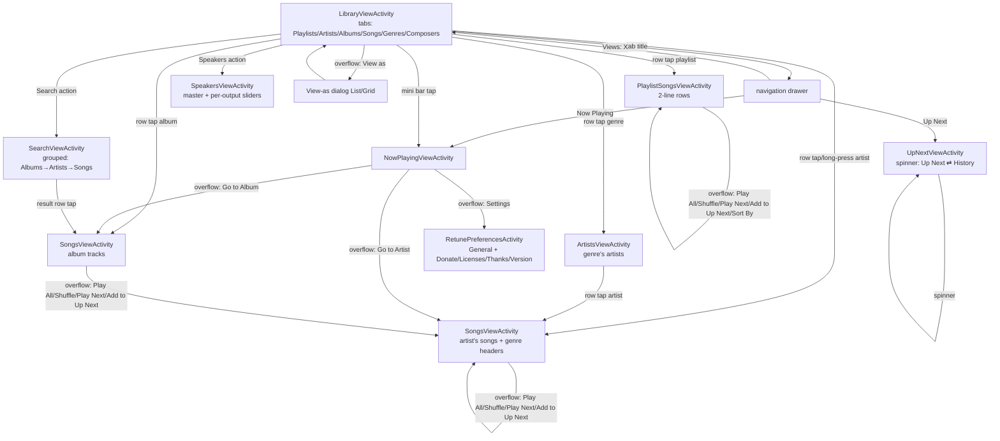

# ReTune navigation graph (captured 2026-11-19, Pixel 6, paired to OwnTone 29.3)

All screens run inside `com.squallydoc.retune`; app bar is constant:
**title(=drawer toggle) · Search · Speakers · More**. The **navigation
drawer** is global (library, np, queue views) and carries: Connected To ·
Playing (Now Playing, Up Next) · Libraries · Views (Playlists, Artists,
Albums, Songs, Genres, Composers, [Radio, Audiobooks — out]).
The persistent **mini now-playing bar** (nano variant: 2 text lines + 3
transport buttons) sits on library/search screens; tap → now playing.

## Back behaviour (observed)
- SongsView/ArtistsView/PlaylistSongs back → **library root (tab
  preserved)** — not to the immediate parent (album→songs→back lands on
  Albums tab; artist→songs→back lands on Artists tab).
- Search back: IME first, then to previous activity.
- Dialogs (View as / Donate / Licenses / Genius-error / Reorder-UPN)
  dismiss on back without side effects.
- HOME + relaunch restores the **last-viewed activity** (came back to Up
  Next), not the library — contrast: new app always cold-starts home.
- Drawer: back closes it.

## Unlabeled/visual-only inventory (a11y gaps → diff candidates)
- Mini-bar transport buttons, np transport + mode buttons: **no
  content-desc at all**.
- Search/Speakers actions DO have content-desc ("Search", "Speakers").
- Play state, mode on/off, playing-indicator, peak meter, volume toaster:
  visual-only (not in a11y tree).

## Not machine-captured (deferred, human review of PNGs)
- Artwork tap behaviour on np; rating star rendering + ratings_dialog
  trigger; peak-meter/visualizer visuals; volume toaster visual;
  mini-bar transport icon identity (prev/play/next assumed from layout
  `nano_now_playing_fragment` — human confirm from PNG).
- "Connecting…" error state (connecting.xml) — needs server-stop
  coordination; spec from API failure modes instead.
